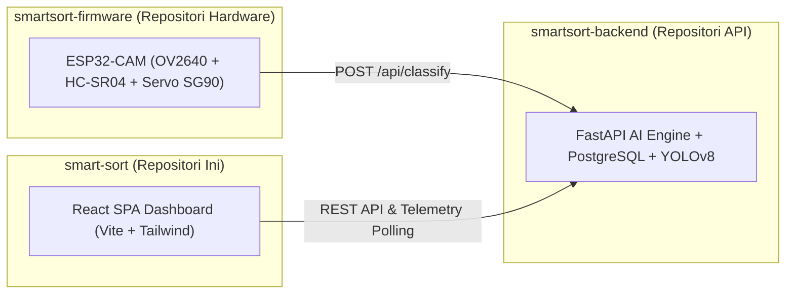

# ♻️ SmartSort - IoT & AI Smart Waste Classifier (Frontend Web Dashboard)

Dashboard monitoring dan kontrol interaktif berbasis web untuk sistem pemilah sampah pintar **SmartSort IoT & AI**. Dibangun menggunakan **React 19**, **Vite**, **Tailwind CSS**, dan **Chart.js** dengan arsitektur murni antarmuka (*Pure Frontend SPA*).

---

## 🏗️ Arsitektur Sistem Terpisah (Decoupled Architecture)

Proyek SmartSort diorganisasikan ke dalam repositori independen yang terpisah:



1. **`smart-sort` (Repositori Ini)**: Web dashboard antarmuka pengguna, visualisasi telemetri, tabel riwayat, dan panel diagnosis manual.
2. **`smartsort-backend`**: Backend produksi REST API, inferensi model YOLOv8, dan persistensi database PostgreSQL.
3. **`smartsort-firmware`**: Kode mikrokontroler Arduino ESP32-CAM (`.ino`).

---

## 🎯 Fitur Dashboard Web

1. **Panel Monitoring (Real-Time)**:
   - Tiga kartu showcase bento: Total sampah terpilah, pratinjau scanner AI kamera OV2640, status sudut servo flap (0° Organik, 30° Residu, 70° Anorganik).
   - Indikator ketinggian kapasitas fisik 3 kompartemen wadah (*Tersedia*, *Waspada*, *Penuh*) beserta tombol *Kosongkan Wadah*.
   - Diagram proporsi pengelompokan sampah (*Doughnut Chart*).
   - Tabel aktivitas 5 pemilahan terbaru secara real-time.

2. **Riwayat & Dataset Pemilahan**:
   - Tabel rekaman dataset penyortiran lengkap (ID, timestamp, kategori, confidence score AI, sudut servo).
   - Filter cepat berdasarkan kategori (*All, Organik, Anorganik, Residu*) dan pencarian instan (*search by keyword/ID*).
   - Ekspor laporan ke format **CSV**.
   - Tombol dialog konfirmasi reset log.

3. **Panel Diagnostik & Pengujian Manual (Plan B / Demo Saver)**:
   - **Manual Servo Override**: Menggerakkan flap ke 0° (Organik), 30° (Residu), dan 70° (Anorganik) secara langsung.
   - **Camera Snapshot**: Memperbarui dan menampilkan jepretan kamera terakhir dari ESP32-CAM.
   - **Data Injector**: Menyuntikkan sampel sampah simulasi untuk demo langsung tanpa menunggu sensor fisik.

---

## 📁 Struktur Direktori Proyek

```text
smart-sort/
├── docs/
│   └── DESIGN.md               # Arsip spesifikasi desain antarmuka
├── public/                     # Aset publik statis (favicon, svg icon)
├── src/
│   ├── api/
│   │   ├── client.js           # Axios instance terpusat & konfigurasi X-API-Key
│   │   └── smartSortApi.js     # Layanan endpoint REST API SmartSort
│   ├── components/
│   │   ├── common/
│   │   │   ├── Navbar.jsx      # Header, logo, navigasi tab, status controller
│   │   │   ├── Footer.jsx      # Footer keterangan teknis & tim
│   │   │   ├── Toast.jsx       # Floating notification toast
│   │   │   └── ResetModal.jsx  # Modal dialog konfirmasi reset
│   │   ├── hero/
│   │   │   ├── HeroSection.jsx # Judul hero & tombol uji simulasi
│   │   │   └── ShowcaseCards.jsx # 3 Bento showcase cards (Stats, Kamera, Servo)
│   │   └── tabs/
│   │       ├── MonitoringTab.jsx # Kapasitas wadah, Donut chart, Recent activities
│   │       ├── HistoryTab.jsx    # Tabel riwayat log, filter, search, unduh CSV
│   │       └── DiagnosisTab.jsx  # Kontrol manual servo, frame kamera, injector
│   ├── constants/
│   │   └── index.js            # Konstanta sudut servo, kategori, styling badge
│   ├── utils/
│   │   └── formatters.js       # Format kategori, persentase, warna kapasitas
│   ├── App.jsx                 # View coordinator utama
│   ├── index.css               # Tailwind CSS & custom styles
│   └── main.jsx                # Entry point React
├── .env.example                # Template konfigurasi environment
├── .env.local                  # Konfigurasi environment lokal (diabaikan git)
├── .gitignore                  # Aturan git ignore root
├── package.json                # Dependencies & script npm
├── run_dev.bat                 # Script double-click Windows untuk dev server
├── tailwind.config.js          # Konfigurasi Tailwind CSS
└── vite.config.js              # Konfigurasi Vite & proxy backend
```

---

## 🚀 Panduan Menjalankan Proyek

### Prasyarat
- **Node.js** v18+ atau v20+
- **NPM** v9+

### 1. Instalasi Dependensi
Jalankan perintah berikut langsung di root repositori:
```bash
npm install
```

### 2. Konfigurasi Environment (`.env.local`)
Salin file `.env.example` menjadi `.env.local`:
```bash
cp .env.example .env.local
```
Sesuaikan nilai variabel lingkungan jika diperlukan:
```env
# URL Backend API (Default menggunakan backend live)
VITE_API_BASE_URL=https://smartsort.ezzar.my.id

# API Key untuk backend (jika backend memproteksi endpoint dengan X-API-Key)
VITE_API_KEY=your_api_key_here
```

### 3. Menjalankan Server Development
Jalankan dev server dengan perintah:
```bash
npm run dev
```
Atau jika menggunakan Windows, Anda dapat melakukan double-click pada file `run_dev.bat`.

Buka peramban di: **`http://localhost:5173`**

### 4. Build untuk Produksi
Untuk mengompilasi bundel produksi:
```bash
npm run build
```
Output build yang siap dideploy akan tersedia di direktori `dist/`.

### 5. Linting
Untuk memeriksa kualitas kode:
```bash
npm run lint
```
